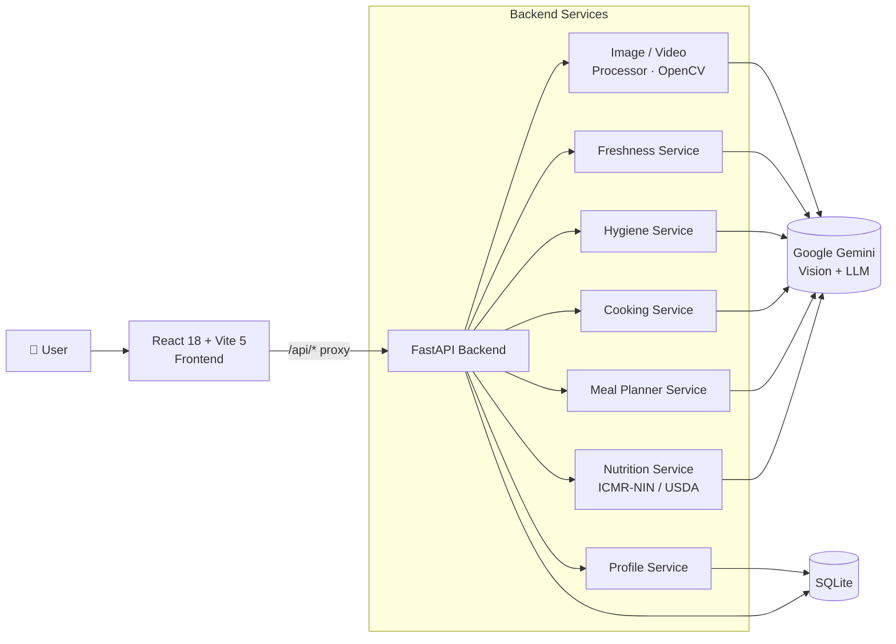

<div align="center">

# 🍽️ FoodVerse AI

### Multimodal Food Intelligence Agent

**One platform for food recognition, freshness detection, hygiene monitoring, smart cooking and personalized meal planning, powered by Google Gemini.**


*Generative AI with Google Cloud · Smart Bridge Capstone Project*

[](https://foodverse-ai-vx2m.onrender.com)

</div>

---

## 📑 Table of Contents

- [Overview](#-overview)
- [Live Demo](#-live-demo)
- [Problem Statement](#-problem-statement)
- [Solution](#-solution)
- [Key Features](#-key-features)
- [System Architecture](#-system-architecture)
- [Tech Stack](#-tech-stack)
- [Project Structure](#-project-structure)
- [Getting Started](#-getting-started)
- [Configuration](#-configuration)
- [API Reference](#-api-reference)
- [Testing](#-testing)
- [Development Approach](#-development-approach)
- [Known Limitations](#-known-limitations)
- [Future Scope](#-future-scope)
- [Author](#-author)

---

## 🔎 Overview

**FoodVerse AI** is a full-stack, multimodal AI platform that analyzes food across multiple dimensions: how it looks, how it is prepared, how hygienically it is handled, and what an individual actually needs to eat.

It combines **computer vision**, **video analysis** and **large-language-model reasoning** (Google Gemini) to deliver real-time, interpretable insights in six modules:

| # | Module | What it does |
|---|--------|--------------|
| 1 | 🍛 Food Recognition & Nutrition | Identifies food from a photo and estimates nutrition |
| 2 | 🥦 Freshness & Spoilage Detection | Assesses visual freshness with confidence levels and safety guidance |
| 3 | 🏥 Restaurant Hygiene Monitor | Analyzes images/video of kitchens and gives a compliance score |
| 4 | 👨‍🍳 Smart Kitchen Assistant | Generates recipes from available ingredients with step-by-step guidance |
| 5 | 📅 Personalized Meal Planner | Builds daily and 7-day plans from goal, diet, allergies and budget |
| 6 | 📊 Dashboard | Calorie history, macro splits, activity feed and PDF export |

---

## 🌐 Live Demo

🔗 **<https://foodverse-ai-vx2m.onrender.com>**

| Item | Details |
|------|---------|
| **Hosting** | Render |
| **Demo account** | `akanksha@example.com` / `FoodVerse1` (or click **Continue with demo account**) |

> ⏳ **Note:** The app is hosted on Render. If it has been idle, the first load may take around 30-60 seconds while the server wakes up. Please wait and refresh once if needed.

---

## ❗ Problem Statement

In households, restaurants and food-service environments, food-related decisions are fragmented and reactive:

- **Nutrition tracking** depends on manual calorie estimation.
- **Food freshness** is judged by eye, without any structured validation.
- **Restaurant hygiene** relies on periodic, after-the-fact inspections.
- **Cooking help** is mostly static recipes with no awareness of context.

These approaches lack real-time intelligence, personalization and a holistic view of food safety, nutrition and preparation. As food ecosystems go digital, there is a clear need for a **unified, multimodal AI system** that can reason across vision, process and personal context.

## 💡 Solution

FoodVerse AI is a **modular, extensible platform** that integrates vision-based analysis, contextual reasoning and personalized recommendations, while keeping outputs **transparent** and the user **in control**. Each capability is an independent module behind a clean API, so new features or data modalities can be added without architectural changes.

---

## ✨ Key Features

### 🍛 Food Recognition & Nutrition Analyzer
- Gemini Vision identifies dishes from photographs.
- Nutrition estimated against **ICMR-NIN** and **USDA** reference data.
- OpenCV preprocessing pipeline for more robust inference across lighting and angles.

### 🥦 Freshness & Spoilage Detection
- Visual freshness assessment with **four confidence levels**.
- Clear food-safety guidance alongside every result.

### 🏥 Restaurant Hygiene & Safety Monitor
- Accepts **images or video** (frame extraction via OpenCV).
- Produces a **compliance score** with identified issues.
- Enables proactive monitoring instead of periodic inspection.

### 👨‍🍳 Smart Kitchen Assistant
- Ingredient-aware recipe generation.
- Step-by-step cooking guidance to improve accuracy and efficiency.

### 📅 Personalized Meal Planner
- Uses a saved profile: **goal, diet type, allergies, budget**.
- Generates **daily** or **7-day** plans.

### 📊 Nutrition Dashboard
- Calorie history, macro breakdown and recent activity feed.
- **PDF export** for all modules (client-side with jsPDF).

### 🛡️ Reliability
- **Automatic Gemini model failover** on quota limits: `3.5-flash-lite → 3.5-flash → 3.7-flash → 3.8-flash`.
- SQLite database auto-initializes on first run.

---

## 🏗️ System Architecture



**Design principles:** modular services · stateless AI inference · interpretable outputs · graceful model failover · single source of truth in SQLite.

See [`docs/ARCHITECTURE.md`](docs/ARCHITECTURE.md) for the complete system and test architecture.

---

## 🧰 Tech Stack

| Layer | Technologies |
|-------|--------------|
| **AI Engine** | Google Gemini Vision / LLM (multi-model failover) |
| **Backend** | Python, FastAPI, Uvicorn |
| **Image / Video** | OpenCV (headless), Pillow |
| **Database** | SQLite |
| **Frontend** | React 18, Vite 5, Recharts |
| **Reports** | jsPDF (client-side) |
| **Testing** | `unittest` (backend), Vitest (frontend) |

---

## 📁 Project Structure

```
FoodVerse-AI/
├── README.md
├── .gitignore
│
├── backend/
│   ├── app.py                     # FastAPI entry point (all routes)
│   ├── database.py                # SQLite schema + persistence
│   ├── image_processor.py         # OpenCV preprocessing pipeline
│   ├── video_processor.py         # Video frame extraction
│   ├── freshness_service.py       # Freshness inference
│   ├── hygiene_service.py         # Hygiene + compliance scoring
│   ├── cooking_service.py         # Recipe generation
│   ├── meal_planner_service.py    # Meal plan generation
│   ├── nutrition_service.py       # ICMR-NIN / USDA reference data
│   ├── profile_service.py         # User profile CRUD
│   ├── requirements.txt
│   ├── .env.example
│   ├── SETUP.md
│   ├── setup_env.py               # Automated venv + install script
│   └── tests/                     # 5 consolidated suites (204 tests)
│
├── frontend/
│   ├── package.json
│   ├── vite.config.js             # Dev server + API proxy
│   ├── index.html
│   ├── public/
│   └── src/
│       ├── pages/                 # 10 page components
│       ├── components/            # Shared UI & landing components
│       ├── context/               # React context providers
│       ├── hooks/                 # Custom hooks
│       ├── styles/                # Design tokens & page styles
│       ├── utils/                 # API helpers & PDF generator
│       ├── data/mock.js           # UI constants & fallbacks
│       └── test/                  # Vitest suites (26 tests)
│
└── docs/
    └── ARCHITECTURE.md
```

---

## 🚀 Getting Started

### Prerequisites

| Tool | Version | Used for |
|------|---------|----------|
| Python | 3.9 – 3.13 | Backend |
| pip / venv | bundled with Python | Backend |
| Node.js | 18+ | Frontend |
| npm | 9+ | Frontend |
| Gemini API key | n/a | All AI features |

> Get a free Gemini API key: <https://aistudio.google.com/app/apikey>

### 1. Clone the repository

```bash
git clone <repo-url>
cd FoodVerse-AI
```

### 2. Backend setup

```powershell
cd backend

# Create and activate a virtual environment
python -m venv venv
.\venv\Scripts\Activate.ps1          # Windows PowerShell
# source venv/bin/activate           # macOS / Linux

# Install dependencies
pip install -r requirements.txt

# Configure environment
Copy-Item .env.example .env          # macOS / Linux: cp .env.example .env
# Open .env and set GEMINI_API_KEY=your_key_here
```

> ⏱️ **Note:** `requirements.txt` includes PyTorch (~2 GB) and TensorFlow as declared Smart Bridge dependencies. Installation can take 5–15 minutes. They are not wired to the live endpoints; Gemini Vision is the active inference engine.

### 3. Start the backend

```powershell
# From backend/
.\venv\Scripts\uvicorn.exe app:app --reload --port 8000
```

- API: `http://localhost:8000`
- Interactive docs (Swagger): `http://localhost:8000/docs`

### 4. Start the frontend

```bash
cd frontend
npm install
npm run dev
```

- App: `http://localhost:5173`
- All `/api/*` requests are proxied to `http://localhost:8000` by Vite.

> ⚠️ **Both servers must be running at the same time** for AI features to work.

### 🔑 Demo Login

| Email | Password |
|-------|----------|
| `akanksha@example.com` | `FoodVerse1` |

Or click **Continue with demo account** on the login page.

---

## ⚙️ Configuration

Create `backend/.env` from `backend/.env.example`:

```env
GEMINI_API_KEY=your_gemini_api_key_here
PORT=8000
```

> 🔒 Never commit your real `.env`. It is excluded via `.gitignore`.

---

## 📡 API Reference

| Method | Endpoint | Description |
|--------|----------|-------------|
| `GET` | `/api/health` | Service status and AI engine info |
| `POST` | `/api/predict` | Food recognition + nutrition (`image`) |
| `POST` | `/api/freshness` | Freshness detection (`image`) |
| `POST` | `/api/hygiene` | Hygiene / compliance analysis (`image`, video also accepted) |
| `POST` | `/api/cooking` | Recipe generation from ingredients / context |
| `GET` | `/api/profile` | Retrieve user profile |
| `POST` | `/api/profile` | Create user profile |
| `PUT` | `/api/profile` | Update user profile |
| `POST` | `/api/meal-plan` | Generate daily or weekly meal plan |
| `GET` | `/api/dashboard/stats` | Dashboard metrics |
| `GET` | `/api/activities` | Recent activity feed |

Full interactive documentation is available at `/docs` while the backend is running.

---

## 🧪 Testing

| Suite | Tests | Command |
|-------|-------|---------|
| Backend | **204** across 5 suites | see below |
| Frontend | **26** across 3 suites | see below |

**Backend**
```powershell
cd backend
.\venv\Scripts\python.exe -m unittest discover -s tests -p "test_*.py" -t . -v
```

**Frontend**
```bash
cd frontend
npm test -- --run
```

**Production build**
```bash
cd frontend
npm run build
```

Tests cover variations in food appearance, lighting and user inputs, plus profile handling, meal planning, preprocessing and system-level edge cases.

---

## 🧭 Development Approach

The project followed a **milestone-driven** process, with each module implemented and validated before integration:

| Milestone | Module | Outcome |
|-----------|--------|---------|
| 1 | Food Recognition & Nutrition Analyzer | Automatic dietary insight from food images |
| 2 | Freshness & Spoilage Detection | Improved food-safety awareness |
| 3 | Restaurant Hygiene & Safety Monitor | Proactive compliance monitoring via video analysis |
| 4 | Smart Kitchen Assistant | Intelligent, ingredient-aware cooking guidance |
| 5 | Personalized Meal Planner | Customized, goal-oriented dietary recommendations |
| 6 | Dashboard & Integration | Unified UI, analytics, PDF reports, end-to-end testing |

---

## ⚠️ Known Limitations

- Gemini outputs are **estimates for informational use only**, not medical or dietary advice.
- Visual analysis **cannot guarantee food safety**; always follow local food-safety standards.
- PyTorch, HuggingFace Transformers and TensorFlow are declared dependencies but are **not wired** to active endpoints.
- **CORS** is configured for `localhost:5173`; update `allow_origins` in `backend/app.py` before any non-local deployment.
- **SQLite** suits local development and demos; use PostgreSQL (or similar) for production multi-user deployment.

---

## 🔮 Future Scope

- Replace SQLite with PostgreSQL and add proper authentication for multi-user deployment.
- Containerization (Docker) and CI/CD pipeline.
- Mobile-friendly / PWA experience with live camera capture.
- Additional modalities (audio, barcode / packaged-food label scanning).
- Wire in custom-trained local models alongside Gemini for offline or low-cost inference.
- Multilingual support and regional cuisine expansion.

---

## 🎯 Conclusion

FoodVerse AI demonstrates the practical application of multimodal AI in the food domain by unifying computer vision, contextual reasoning and personalized recommendation into one platform. Its modular architecture makes it scalable and maintainable, and it serves as a strong foundation for future research and real-world deployment in households, restaurants and food-service environments.

---

## 👩‍💻 Author

**Akanksha Singh**
B.Tech, Data Science (3rd Year)

[](https://www.linkedin.com/in/akanksha-singh-4715a0351/)
[](mailto:akanksha24d@gmail.com)
[](mailto:0241csds181@niet.co.in)

---

## 📄 License

See [`LICENSE`](LICENSE) for terms. *(Add a license file before publishing.)*

<div align="center">

*Built with ❤️ by **Akanksha Singh** · FoodVerse AI · Generative AI with Google Cloud · Smart Bridge Capstone Project*

</div>
